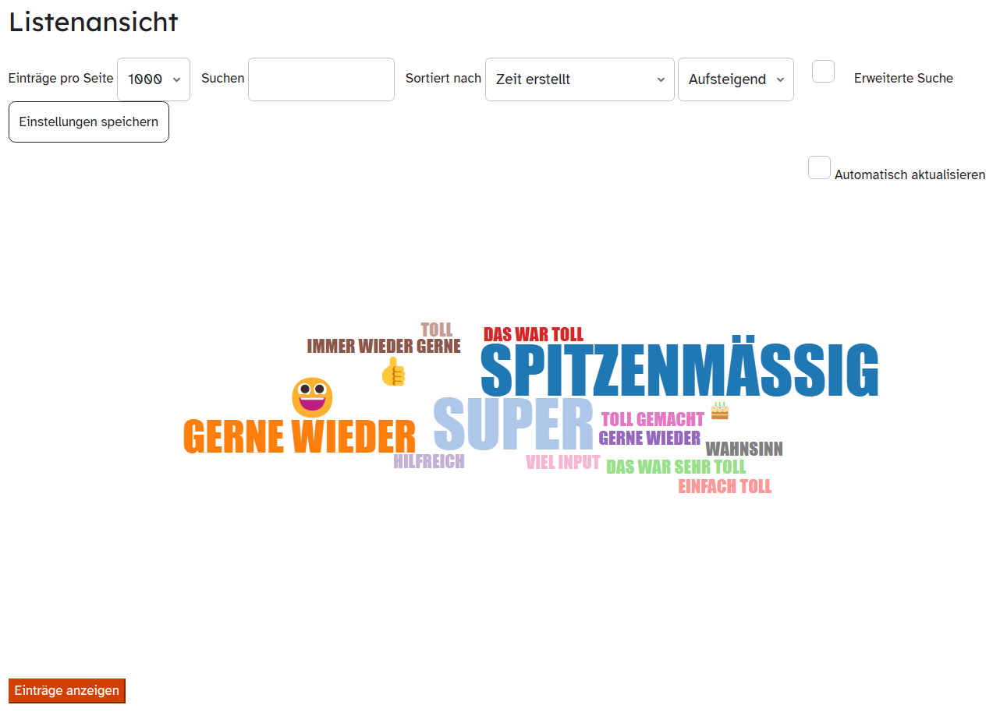

# Word Cloud

Word Cloud is a preset for the Moodle activity database.

## Description

Users enter words into three text fields. A word cloud is generated from all
submissions and displayed on the list view.

The cloud is rendered as SVG with a small custom script – no external
libraries (no D3, no CDN), works offline.

Features:

- Biggest word in the vertical centre, sizes decreasing towards the edges
  (pyramid layout)
- Fixed colour palette, no rotation
- Case-insensitive counting; words with a single occurrence are included
- Responsive: the cloud scales down on small screens
- Auto reload option: fetches the page in the background every 15 s without a
  full page reload (no flicker, scroll position preserved)
- Action menus (`##actionsmenu##`) in the entry cards and single view
- Download button: save the cloud as an SVG file
- Entry list as a responsive card grid
- Styled add-entry form with a hint about the semicolon format

## Requirements

- Moodle 4.1 or newer (the templates use the `##actionsmenu##` tag,
  MDL-75275)

## Getting started

Download the [release file](https://github.com/fdagner/word-cloud__moodle-database-preset/releases/tag/publish). Create a "Database" activity in Moodle and then upload the ZIP file in the "Presets" tab under "Import".

## Language Support

The preset is available in German, but there is not so much to translate. The template can easily be adapted.

## Screenshots

